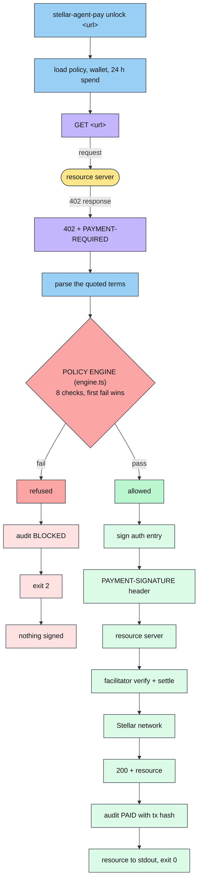

# Architecture

## Layout

```
src/cli.ts             commander wiring, argument types, error handling
src/commands/
  unlock.ts            the payment path, output rendering, remediation hints
  status.ts            wallet, balances, policy and 24 h spend
  policy.ts            show, set, allow, block, unblock, remove, reset, path
  wallet.ts            new, import, show, trustline, friendbot, changeTrust
  audit.ts             reading and filtering the log
  init.ts              first run setup
src/core/
  policy.ts            zod schema, load and save, domain matching, overrides
  engine.ts            the rules, one Check each, evaluated in order
  x402.ts              x402 client construction and the policy hook
  audit.ts             audit.log and events.jsonl, budget accounting
  money.ts             bigint atomic units, decimals, rescaling
  wallet.ts            key resolution, env before file
  paths.ts             where state lives, permissions, JSON io
  output.ts            colour, tables, stdout versus stderr
  errors.ts            CliError and the exit code constants
examples/
  mock-seller/         offline 402 emitter, no facilitator, for demos and CI
  seller/              real @x402/express seller for testnet
scripts/
  smoke.mjs            end to end run used by npm run smoke and by CI
  test.mjs             test runner that resolves files without a shell glob
```

## The payment path



The branch on the left is the whole point of the tool. It exits before `sign auth entry`, so a refused payment leaves no signature behind, not even an unsubmitted one.

## Where enforcement happens

This is the load bearing design decision.

`@x402/core` exposes an `onBeforePaymentCreation` hook on the client. It fires after the payment terms have been selected and **before** the scheme builds and signs anything. Returning `{ abort: true, reason }` makes the core client throw, so no authorization entry is ever produced.

```ts
const client = new x402Client()
  .register(network, new ExactStellarScheme(signer))
  .onBeforePaymentCreation(async (context) => {
    decision = evaluate({ url, requirements: context.selectedRequirements, policy, spend });
    if (!decision.allowed) {
      return { abort: true, reason: `[${violation.rule}] ${violation.detail}` };
    }
  });
```

See [`src/core/x402.ts`](../src/core/x402.ts).

Two consequences worth stating plainly:

1. A refusal is not a cancelled payment, it is a payment that never existed. There is no signature to leak, replay or partially submit.
2. The check runs against the terms the server actually quoted, not against what the CLI expected. A server that quotes one price and then asks for another is caught, because the hook sees `selectedRequirements`.

The decision object is captured in a closure. When the core client throws, `unlock` consults it: if a refusal is recorded, this was a policy block and the exit code is `2`. Any other throw is a genuine failure and exits `1`.

## Preflight, when there is no wallet

If no payer key is configured, or with `--dry-run`, the CLI takes a different path: a plain `fetch`, and if the answer is 402, the terms are parsed with `x402HTTPClient.getPaymentRequiredResponse`, which handles both v1 bodies and the v2 `PAYMENT-REQUIRED` header.

The same `evaluate()` runs on those terms. The verdict is identical to what the real path would produce, which is what makes `--dry-run` trustworthy: it is not a simulation of the rules, it is the rules.

## Money

Every amount is a `bigint` in atomic units. No float ever touches a value.

Stellar assets carry **7 decimals**, not the 6 that EVM USDC uses. `0.001 USDC` is `10000` atomic units. Getting that wrong is off by a factor of ten, which is why `money.ts` is a separate module with its own tests.

Policy limits are denominated in 7 decimal units. A quoted amount in an asset with different precision is rescaled with `toPolicyUnits` before comparison, rounding **up** when narrowing precision, so rescaling can never under-report a payment against a cap.

## State on disk

| File           | Contents                                       | Sensitive                  |
| -------------- | ---------------------------------------------- | -------------------------- |
| `policy.json`  | The rules                                      | No, ship it with the agent |
| `wallet.json`  | The payer secret, `0600` where supported       | Yes                        |
| `audit.log`    | Human readable line per attempt                | Contains URLs and amounts  |
| `events.jsonl` | Structured ledger, source of budget accounting | Contains URLs and amounts  |

All under `~/.stellar-agent-pay`, or `$STELLAR_AGENT_PAY_HOME`. Pointing that variable somewhere else per agent is how you isolate budgets and history.

## Errors and exit codes

`CliError` carries a message already written for a person and an exit code. `cli.ts` prints it without a stack trace. Anything else is printed with a hint about `STELLAR_AGENT_PAY_DEBUG=1`.

`0` unlocked, `1` error, `2` refused by policy. The split matters: an agent must be able to tell "I was not allowed to buy this" from "the network is down", because the correct reaction is different. See [Driving it from an agent](for-agents.md).

## Dependencies

| Package                     | Why                                                                |
| --------------------------- | ------------------------------------------------------------------ |
| `@x402/fetch`, `@x402/core` | The x402 v2 client and the hook the policy attaches to             |
| `@x402/stellar`             | The `exact` scheme for Stellar, the ed25519 signer, USDC constants |
| `@stellar/stellar-sdk`      | Horizon queries, keypairs, trustlines                              |
| `commander`                 | Subcommand parsing                                                 |
| `zod`                       | Policy schema validation, so a malformed file fails closed         |
| `dotenv`                    | Loading `.env` from the working directory                          |

Testing and tooling only: `typescript`, `tsx`, `eslint`, `typescript-eslint`, `prettier`, `husky`, `lint-staged`, plus `express` and `@x402/express` for the example seller.

## Verification

| Layer               | What it covers                                                                                                                              |
| ------------------- | ------------------------------------------------------------------------------------------------------------------------------------------- |
| `npm test`          | 24 unit tests over money conversion, domain matching, override precedence, every policy rule, and audit accounting                          |
| `npm run smoke`     | Boots the mock seller and drives the real binary end to end, asserting exit codes and JSON, with no keys or network                         |
| `npm run typecheck` | `tsc` over `src` and `test`                                                                                                                 |
| `npm run lint`      | Type aware eslint                                                                                                                           |
| CI                  | Each of the above as its own workflow, on Node 20, 22 and 24, on Ubuntu and Windows, plus CodeQL, gitleaks, dependency review and npm audit |

## Not shipped yet

MPP channel mode, where the client deposits once and signs cumulative off-chain commitments per request, settling on close. Two blockers: `@stellar/mpp` currently pins `@stellar/stellar-sdk@^15` while `@x402/stellar@2.20` requires `^16`, and channel mode needs a one way channel contract deployed per session. When it lands it reuses this same policy engine and audit log, with the per-request check applied to each commitment.
